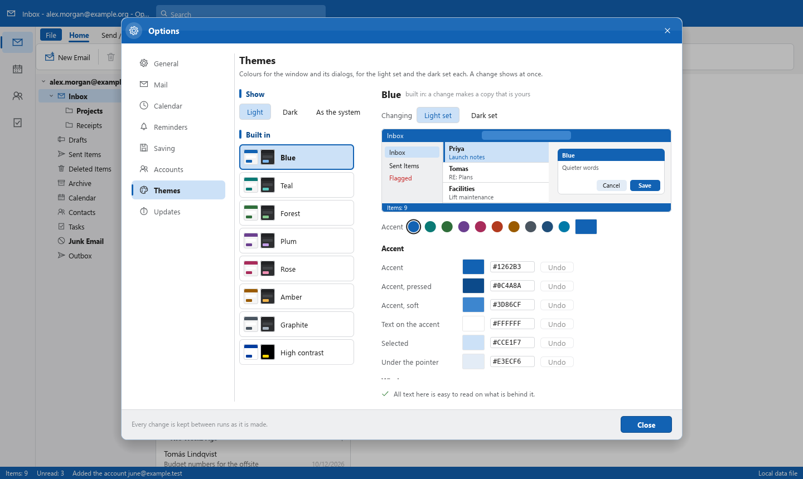
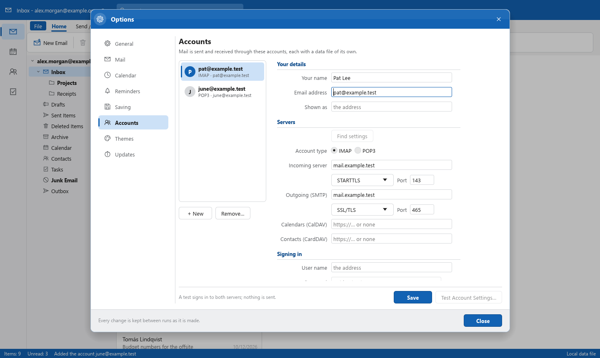
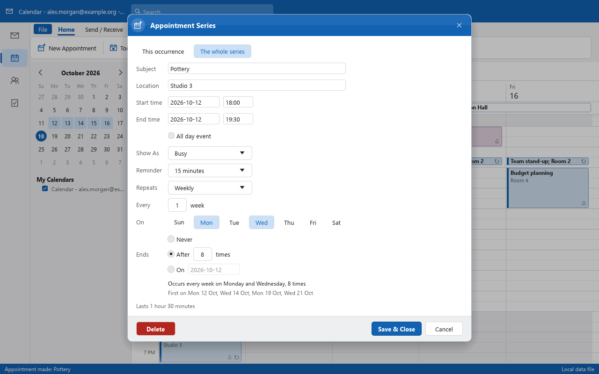
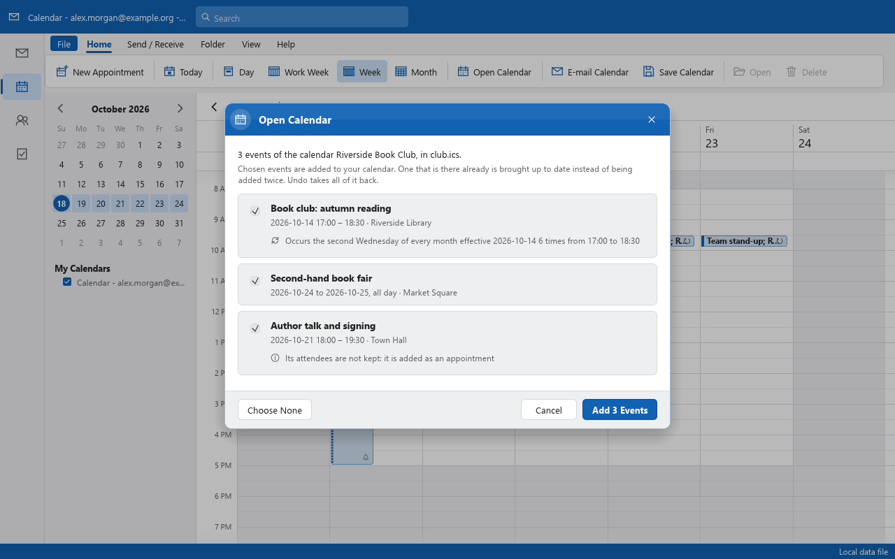
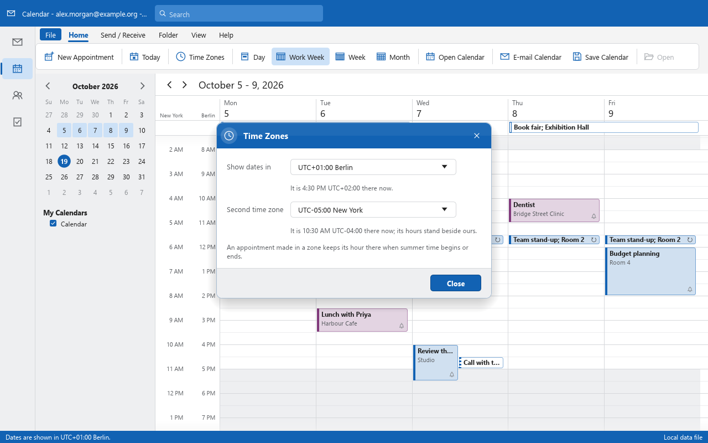
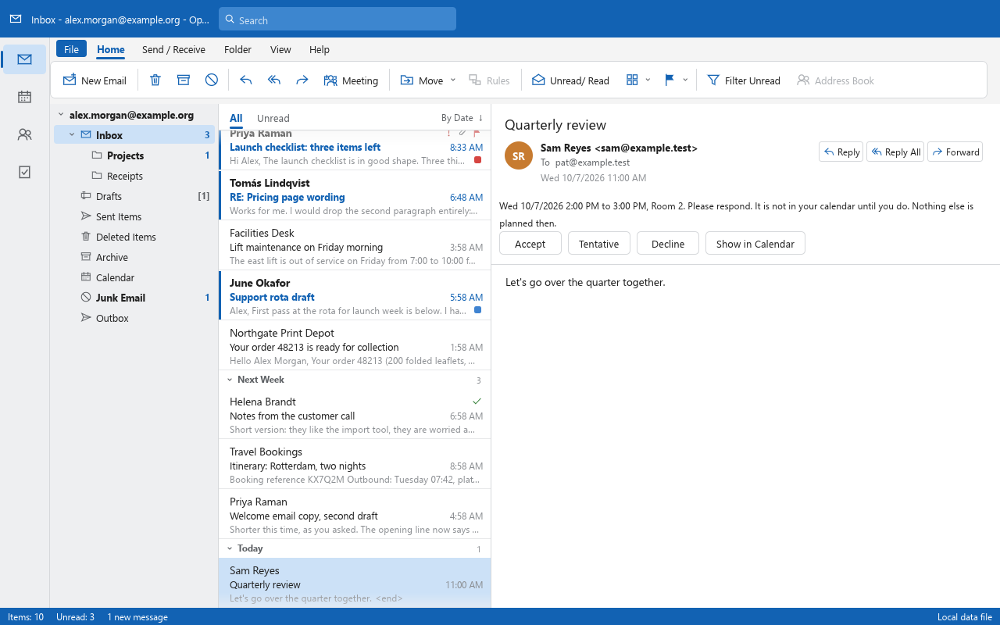
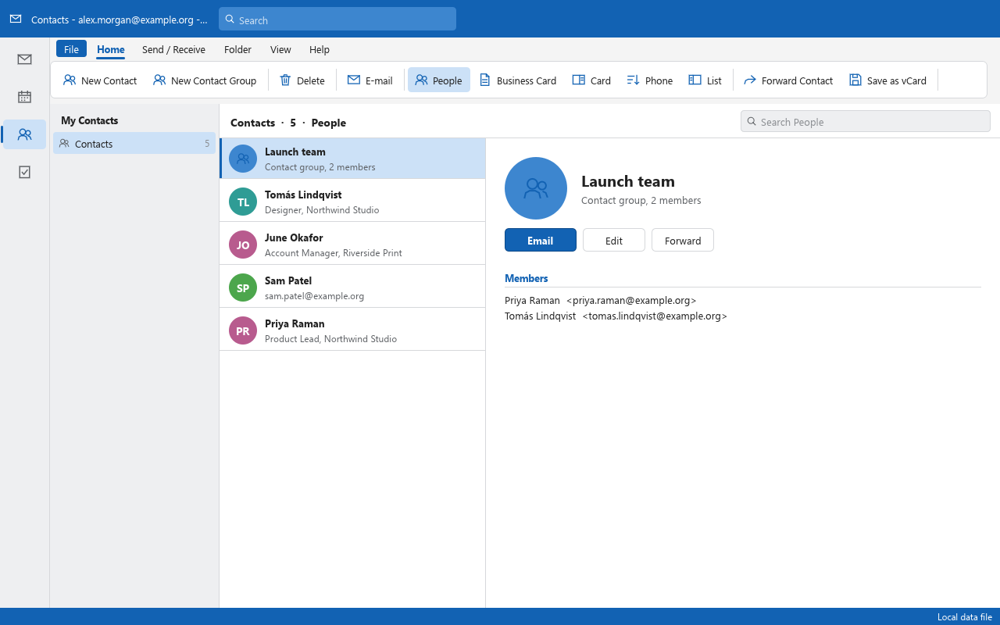
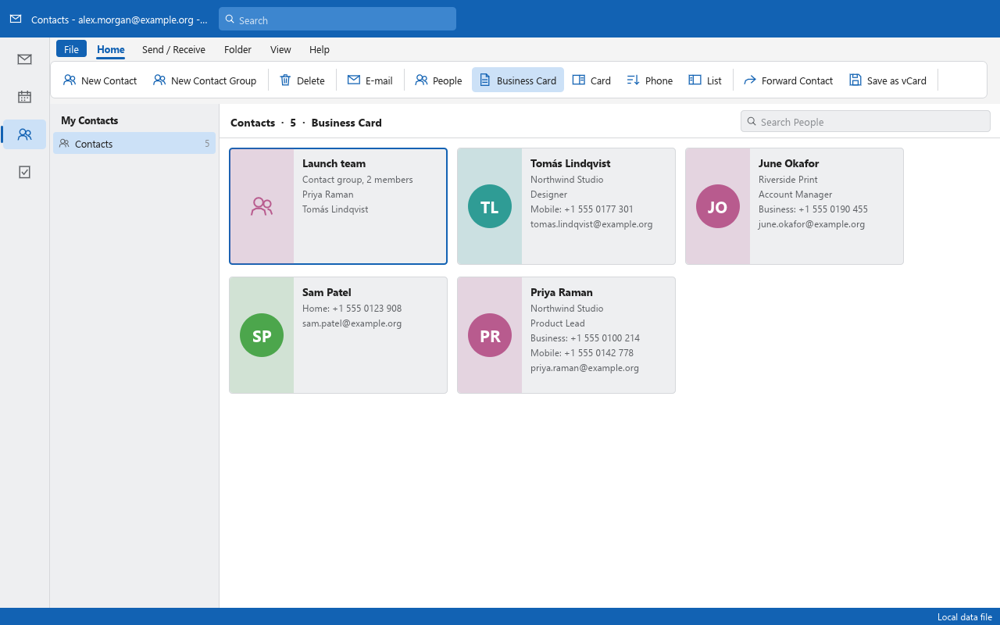

# OpenMailClient


A clean-room, open-source mail client written in Rust, aiming at parity with Microsoft Outlook Classic
(the Win32 desktop Outlook): the same layout and behaviour, files that go both ways, and every feature
reachable as a command from the UI, a CLI and (later) an MCP server.

Project page: https://adriaanboshoff.github.io/OpenMailClient/

OpenMailClient is an independent concept project. It is not affiliated with Microsoft. It follows the
conventions of [`storytold/wordcraft`](https://github.com/storytold/wordcraft).


*The sample mailbox (invented content), drawn by `ui_shot`. The receipt is stored only as RTF.*

## Screenshots

Every picture is the app drawing its own invented sample mailbox, headless, with `ui_shot`
(`cargo run --release -p openmailclient-ui-egui --example ui_shot -- script.jsonl`).

| | |
|---|---|
|  |  |
| **Dark theme.** Unread, flagged and important mail, date groups, categories. | **Replying in place.** It notices a mentioned attachment that is missing. |
|  |  |
| **Calendar, week.** All-day events, side-by-side overlaps, the time now. | **Calendar, month,** in the dark theme. |
|  |  |
| **New appointment.** Dialogs take the theme's colours. | **Themes of your own,** each with a light and a dark set and a contrast check. |
|  |  |
| **Account Settings.** IMAP or POP3 over TLS, servers found from the address. | **Print** on a printer or to PDF, the message body alone if you like. |
|  |  |
| **Opening an attachment.** A file passing for another kind is only saved. | **Recurring appointments.** One occurrence or the whole series, the pattern in words as you choose it. |
|  |  |
| **Open Calendar.** Each event shown and chosen; one you have already is brought up to date. | **Time zones.** Summer time kept, a second zone's hours beside ours. |
|  |  |
| **Meetings,** answered from a bar above the invitation, to and from Outlook. | **People,** found in every field as you type; vCard files shown card by card first. |
|  | |
| **Five views** as Outlook has them: People, Business Card, Card, Phone and List. | |

## Progress

The numbers are measured, not estimated: [ROADMAP.md](ROADMAP.md) has the headline numbers and the
progress log, [docs/parity-checklist.md](docs/parity-checklist.md) is generated from the feature
catalog, and [docs/gaps.md](docs/gaps.md) ranks what is missing.

### Milestones

| | Milestone | State |
|---|---|---|
| M1 | **Data files first**: open `.pst`/`.ost`/`.msg`/`.eml` in an Outlook-Classic-style window; save messages Outlook can reopen |  |
| M2 | **Formatted reading**: HTML and RTF bodies laid out and drawn, pictures, printing |  ([do later](ROADMAP.md#do-later-from-m2)) |
| M3 | **Writing `.pst`**: a mailbox saved as a `.pst`, changes to an open one kept, settings kept |  ([do later](ROADMAP.md#do-later-from-m2)) |
| M3b | **The do-later batch**: journalled changes, a save into the data file where it is, and what M2 and M3 left |  |
| M3c | **Proof in Outlook, 4K-page writing**: files we write open in Outlook Classic (done); 4K-page data files written (done); changes saved on their own (done); a changed message's size (done); files from before M3c.1 (done); hidden items exported from an `.ost` (done); compressed 4K-page blocks (done) |  |
| M4 | **Accounts**: IMAP, POP3 and SMTP; protocol clients tested against a fake server (done); TLS with checked certificates, passwords in the system's credential store (done); a server's own certificate trusted on the owner's word, for that server only (done); accounts added, tested and kept (done); mail sent and kept in Sent Items (done); mail received by POP3 and IMAP, F9 (done); new mail told of at the corner of the screen and with a sound of our own, Send/Receive on a timer, its progress in a window of its own with a way to stop it (done); Delay Delivery and Expires After, a held message going at its minute (done); Account Settings in the window, the servers found from the address and its domain's DNS records (done); each account in a data file of its own (done); pictures on a server downloaded when asked for, over HTTPS only (done); attachments opened or saved on a double-click, a program or script only saved (done); checked against a real server (done). OAuth sign-in is M8 |  |
| M5 | **Calendar, People and Tasks**: the Calendar's day, work week, week and month views, appointments made, changed and deleted (done); Import from Outlook: accounts and their mail, calendar, contacts and tasks (done); recurring appointments, one occurrence changed alone (done); `.ics` calendar files opened and saved (done); calendars kept in step with a CalDAV server, as with Nextcloud (done); time zones (done); meetings, invitations sent and answered (done); time zones with their summer time, a second zone beside ours (done); People, contacts and contact groups in five views and vCard files opened and saved (done); Tasks and the To-Do List, flagged mail beside tasks (done); reminders for appointments, tasks and flagged mail (done); contacts kept in step with a CardDAV server, the Address Book, Check Names and Mail Merge (done); to-dos in calendar files (done); tasks kept in step with a CalDAV server's task lists (done); the To-Do Bar (next) |  |
| M6 | **MCP server, control channel, web build** |  |
| M7 | **Web access**: the mailbox, calendar, people and tasks from a browser on any device, served over HTTPS by OpenMailClient itself from the machine it runs on, through no one else's server; off until turned on, a browser paired once and signed in with a passkey, a layout for phones too |  |
| M8 | **Third-party sign-in**: Gmail, Outlook.com and Microsoft 365, Yahoo and others through OAuth 2.0 (XOAUTH2, OAUTHBEARER), signed in through the system's browser, tokens in the system's credential store; until then such accounts sign in with an app password |  |

Closed milestones still have work left over: it is not dropped. Each piece is a row in
[Do later](ROADMAP.md#do-later-from-m2) with the slot it lands in, and is struck when it lands.
71 rows are done; 30 are open: 18 in M5, 1 in M6, 1 in M8 (after the first release), 1 with M1's checks against
Outlook, and 9 that wait on something we do not have yet (an Outlook-written file of a kind we may
read, a reader we can try without driving a window, a printer we may use).

### Outlook Classic features with a command

| Area | Done | | |
|---|---|---|---|
| Mail | 38 of 68 | `███████████░░░░░░░░░` | 56% |
| File | 12 of 16 | `███████████████░░░░░` | 75% |
| Message window | 6 of 18 | `██████░░░░░░░░░░░░░░` | 33% |
| Calendar | 17 of 19 | `█████████████████░░░` | 89% |
| People | 4 of 5 | `████████████████░░░░` | 80% |
| Tasks | 7 of 8 | `█████████████████░░░` | 88% |
| **All** | **84 of 134** | `████████████░░░░░░░░` | **62%** |

### File formats and protocols

| | Read | Written |
|---|---|---|
| `.pst`, `.ost` (ANSI, Unicode, 4K pages) | yes | a whole mailbox as a new Unicode, ANSI or 4K-page `.pst`; changes to an open `.pst` of any of the three are kept by Save Changes, and the file stays the kind it was (Outlook Classic opens them and sees what was written) |
| `.msg`, `.oft` | yes | yes |
| `.eml` | yes | yes |
| `.ics` | yes, each event shown before it is added; one opened again brings what is there up to date | yes, the calendar, a range of days or one appointment, with its series |
| `.pdf` | | yes, a message (Memo Style) or a folder's list (Table Style), printed |
| IMAP, POP3, SMTP | accounts are set up and tested in Account Settings, mail is sent and received into each account's own data file, checked against a real server; every IMAP folder is taken down, what is sent is put in the server's Sent folder, read, flagged, moved and deleted messages go both ways, folders renamed, moved and deleted are followed both ways, and drafts are kept on the server as they are written (M4) | the same |

## What works today

- Opens Outlook data files (`.pst`, `.ost`) and single messages (`.msg`, `.oft`, `.eml`). Nothing is
  written to a data file until Save Changes (Ctrl+S): changes to a Unicode or ANSI `.pst` are then written
  into the file where it is, so a flag on one message is a few pages and not the mailbox again. What a save
  writes over is kept beside the file until the save is checked and read back, and is put back if anything
  goes wrong, a power cut included; the first save keeps the file as it was beside it and writes a whole
  new file that is checked, read back and swapped in. Until then each change is journalled beside the file (or in a folder of our own when that
  one cannot be written), so a crash or a
  closed window does not lose it: it comes back, still unsaved, when the file is opened again.
  `.ost` files are read-only. Once a file has been saved, later changes are saved on their own
  after five minutes at a quiet moment (`file.autoSave`). A save or an export runs beside the window, with
  progress and a way to stop it, and a structure check (`inspect --check`) reads a data file
  through without changing it.
- An Outlook-Classic-style window: ribbon (simplified and classic), folder pane, message list with
  date groups, reading pane; dialogs in the theme's colours; nine built-in themes and themes of
  your own, each with its own light and dark colours, any of 25 colours changed with a live
  preview and a contrast check, or following the system's light or dark setting.
- Read, flag, categorise, move, delete, archive, search, sort and filter in writable (in-memory) stores.
- Reply, reply all, forward and new mail as drafts; saving messages as `.msg`, `.oft` or `.eml`.
- **Formatted bodies.** HTML and RTF mail is laid out and drawn: fonts the message names (installed
  ones only), colours, lists, links, tables (cell borders, fills, merged cells, tables inside cells),
  paragraph borders and spacing, bordered and filled blocks inside one another, rounded corners, borders round
  text within a line, a colour behind the whole body, line spacing, tab stops, right-to-left text. Nothing in a message is run and
  nothing is fetched.
- **Pictures.** Attached and written-in pictures (PNG, JPEG, GIF, WebP, TIFF, SVG, bitmaps, Windows and enhanced metafiles
  that are drawings, with the bitmaps, hatched and patterned brushes and clipped regions in them) are decoded in-process and drawn in the text; animated GIF, PNG and WebP
  pictures are played, or stand still when asked (`view.animations`); pictures stand at the sides of
  a paragraph with the text beside them; an attachment that stands in the
  text is a card that a click asks about: open it or save it.
- **Printing.** A message (Memo Style) or a folder's list (Table Style) prints to a PDF file, with
  tables, borders and pictures; a print window shows the pages beside the page setup (paper,
  direction, margins, header and footer) and has a zoom; Table Style prints the columns chosen,
  group headings and the selected row. It prints on any printer the system has, with copies and a
  page range, on a thread of its own, or saves the pages as a PDF file; the name and message
  details and the page header and footer can each be left off, down to the message body alone.
- **Calendar files.** An `.ics` file, or one attached to a message, is shown event by event before
  anything is added; an event the calendar has already is brought up to date instead of added
  twice, and one Undo takes all of it back. The calendar, a range of days or one appointment is
  saved as an `.ics` file, or sent by mail as a file and a list.
- **CalDAV calendars.** Give an account a CalDAV server (Nextcloud, Radicale, Fastmail…) and
  each of its calendars is kept in step with a Calendar folder of the account's data file on
  every Send/Receive, both ways, over HTTPS; a change made on both sides keeps both. My
  Calendars lists them in their own colours.
- **Time zones.** Dates are shown in the system's zone, or one you choose, with its summer time.
  An appointment keeps the zone it was made in, so a weekly 09:00 meeting stays at 09:00 when the
  clocks change; one typed in another zone says when it is where you are. A second zone's hours
  can stand beside ours in the day and week views.
- **Meetings.** Invite people to an appointment, required, optional or a room, and they get an
  invitation any mail program shows as one. An invitation you get has a bar that says when and
  where, what else you have then, and Accept, Tentative or Decline; it goes in your calendar only
  once you answer, and answers and cancellations count only from the person they must come from.
  The organizer sees who answered how, and can send updates or call the meeting off. Meetings
  go both ways with Outlook: its requests, sent as a calendar alone or kept in a data file by
  their properties, are read and answered, and ours carry what Outlook reads.
- **Import from Outlook.** Every IMAP and POP3 account of the Outlook profiles, with its servers and
  without its password, and the profiles' data files: shown first, then copied without changing
  Outlook's own files, an `.ost` made a `.pst` of our own.
- **An installer and updates.** A Windows installer with Start menu and desktop shortcuts, and
  Check for Updates from this repository's GitHub releases, pre-releases too, each installer
  checked by its SHA-256 before it is run.
- A sample mailbox with invented content, for trying things without any real mail.

## What does not work yet

- **Proof against Outlook.** `.pst` files written here open in Outlook Classic with every folder
  and message as written, whole, ANSI and saved into in place; a file written before M3c.1 is written
  whole on its next save, keeping its ids, and then opens too; an `.ost` is exported with its
  hidden items as a `.pst` Outlook opens. No Outlook-written `.pst` has been saved into yet. A 4K-page file is
  written whole on every save (M3c.2), its larger blocks deflated as Outlook stores them (M3c.7).
- **Parts of formatted bodies.** Right-to-left text while it is typed; complex scripts
  on screen beyond what egui shapes; metafiles that copy with a mask or see-through; the
  printer's own settings (trays, two-sided). Each is scheduled in
  [ROADMAP.md](ROADMAP.md#do-later-from-m2).
- The To-Do Bar and the Scheduling Assistant.
- The MCP server, the control channel and the web build.
- Signed installers, and packages for macOS.

## Download

The newest pre-release, **0.1.0-alpha.2**, is on the
[releases page](https://github.com/AdriaanBoshoff/OpenMailClient/releases) for Windows and Linux.

**Windows 10 and 11 (x64):** `OpenMailClient-0.1.0-alpha.2-windows-x64-setup.exe`. It installs for you alone unless you
choose everyone, needs no administrator, and asks whether to put OpenMailClient on the Start menu
and the desktop. Uninstalling it leaves your mail, settings and accounts where they are.
`SHA256SUMS.txt` beside it gives the installer's SHA-256.

The installer is not signed yet, so Windows SmartScreen may ask whether to run it ("More info",
then "Run anyway").

**Linux (x64):** `OpenMailClient-0.1.0-alpha.2-linux-x64.tar.gz`, for any distribution with glibc
2.31 or newer (Ubuntu 20.04, Debian 11, Fedora 32 and since) and an X11 or Wayland desktop. It
installs for you alone, under `~/.local`, with no administrator, and puts OpenMailClient among
your applications:

```bash
tar xzf OpenMailClient-0.1.0-alpha.2-linux-x64.tar.gz
```

```bash
OpenMailClient-0.1.0-alpha.2-linux-x64/install.sh
```

`install.sh --uninstall` takes it away again and leaves your mail, settings and accounts where
they are. The programs also run from the folder as they are, without installing. Passwords are
kept in the desktop's secret service (GNOME Keyring or KWallet).

`SHA256SUMS.txt` gives the SHA-256 of both. It is an alpha: keep a copy of any data file you open
with it.

**Updates.** Help, Check for Updates asks GitHub for the newest release, shows what it says of
itself, downloads its installer and checks it against the release's `SHA256SUMS.txt` before
anything is run; it is installed when OpenMailClient closes, after every change is saved, and
OpenMailClient starts again. Pre-releases are offered when "Offer pre-releases too" is on, and
always to a pre-release. It looks once a day on its own and only tells; nothing is downloaded or
installed without being asked. Installers are taken only from this repository's releases. On
Linux it tells of a new release and opens its page; the archive is installed as above.

To make the packages yourself, run this on each system. On Windows it makes the installer with
[Inno Setup 6](https://jrsoftware.org/isinfo.php). On Linux it makes the archive, linked against
glibc 2.31 when [cargo-zigbuild](https://github.com/rust-cross/cargo-zigbuild) and Zig are
installed (`GLIBC=2.35` picks another):

```bash
cargo xtask package
```

## Run it from source

```bash
cargo run --release -p openmailclient -- --sample
```

```bash
cargo run --release -p openmailclient -- path/to/archive.pst
```

The page setup, the panes and their sizes, the window's size and place, the theme and the data files that were open are kept between runs in
`settings.json` in the per-user configuration folder (`%APPDATA%\OpenMailClient` on Windows) and
the data files are opened again when a run names none. To start without it:

```bash
cargo run --release -p openmailclient -- --no-settings
```

Without a window:

```bash
cargo run --release -p openmailclient-cli -- inspect path/to/archive.pst --check
```

```bash
cargo run --release -p openmailclient-cli -- inspect path/to/message.msg --props
```

Commands can also be run on the window's own settings, accounts and data files (close the
window first); what changed is saved at the end:

```bash
cargo run --release -p openmailclient-cli -- run --profile --cmd account.receive
```

```bash
cargo run --release -p openmailclient-cli -- convert message.msg message.eml
cargo run --release -p openmailclient-cli -- convert mailbox.ost copy.pst
```

A screenshot of the real UI without opening a window:

```bash
cargo run --release -p openmailclient-ui-egui --example ui_shot
```

## Safety rules the code follows

- **Never crash, never lose mail.** No panics in non-test code; every reader has a hostile-input test;
  a data file is not written to until a save is asked for; a save writes a temporary file, checks it and swaps it in, or writes into the file with an undo file beside it that puts it back byte for byte if the save does not end.
- **Mail is hostile and private.** Message content is data: nothing in a message is run, and remote
  content is never fetched by itself: pictures are downloaded only when you ask, over HTTPS, and never from your own network. An attachment is opened only when you say so on a double-click, as a read-only copy marked as from the internet; a program or a script is only ever saved to a file you choose.
- **Clean room.** Formats come from public specifications ([MS-PST], [MS-OXMSG], RFC 5322, …). No
  Microsoft code, icons, fonts or wording; icons are drawn in code.

Details: [CLAUDE.md](CLAUDE.md).

## Development

```bash
cargo xtask ci
```

runs formatting, clippy with warnings denied, the tests, and the asset, layering, parity and wasm checks.

## Licence

MIT or Apache-2.0, at your option.
